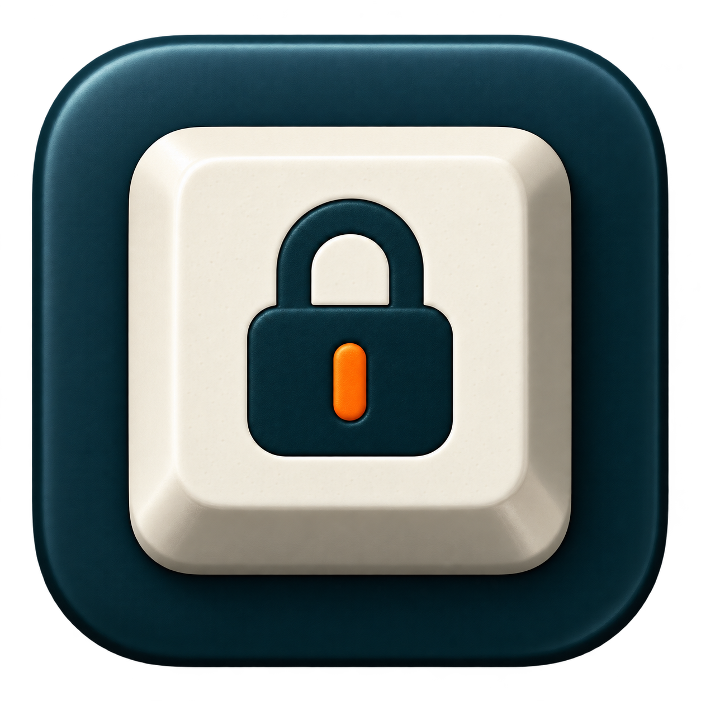

# KeyLatch



A small native macOS keyboard-lock utility with a custom unlock chord and an automatic unlock timer.

**Preview software.** Chord logic, timer boundaries, and 100 state-machine relock cycles pass automated tests. Two interactive timer-unlock cycles were checked. Reliable physical keyboard blocking across apps has not yet been verified. An automated input test reached another app while the UI reported locked. Do not rely on this as a security boundary.

## Download

Get the DMG from [Releases](https://github.com/jungbtc/KeyLatch/releases). The published preview targets **Apple Silicon, macOS 13 or later**. It does not support Intel Macs. Building from source targets the architecture of the build machine; Intel builds have not been tested.

The app and `KeyLatch-Notarized-AppleSilicon.dmg` are **Developer ID signed and notarized**. Gatekeeper accepted the final DMG on the build Mac. See [Apple's signing and notarization explanation](https://support.apple.com/guide/security/sec3ad8e6e53/web).

## Use

1. Open the DMG and drag KeyLatch into Applications.
2. Enable KeyLatch in System Settings > Privacy & Security > Accessibility.
3. Choose 2 to 6 different letters, such as `asdf`.
4. Start with a 10-second automatic unlock timer, then click **Lock keyboard**.
5. Hold all chord keys together and release all keys to unlock. Typing them sequentially does not unlock.

Chords use physical US keyboard positions, independent of input language. The mouse stays available. The window and menu bar both offer an unlock action. Quitting, sleep, and interrupted capture release the lock. Closing the window leaves the app in the menu bar. The app always launches unlocked.

This is a convenience tool for preventing accidental typing, not a password or screen lock. Secure input, OS-reserved actions, the login screen, and other sessions can bypass the filter. Different keyboards may also limit simultaneous key combinations.

## Build and test

Requires macOS and Apple's Command Line Tools with Swift. No third-party packages are required.

```sh
./build.sh
./build/KeyLatch.app/Contents/MacOS/KeyLatch --self-test
open build/KeyLatch.app
```

The default build is ad hoc signed for local testing. It does not replace an installed copy. Replacing an ad hoc build can invalidate its Accessibility permission; remove the old entry and add the current app again if necessary.

For a Developer ID signed build, use an identity already installed with its private key in your Keychain:

```sh
KEYLATCH_SIGNING_IDENTITY='Developer ID Application: Your Name (TEAMID)' ./build.sh
```

The signed build enables Hardened Runtime and requests a secure timestamp. You must complete notarization separately before claiming the build is notarized. Never commit certificates, private keys, passwords, or API credentials.

`KEYLATCH_BUILD_APP` optionally overrides the output app path.

## Implementation and privacy

The app uses AppKit and a filtering Core Graphics event tap in the current login session. Every lock gets a fresh capture connection. UI updates and teardown are deferred out of the event callback. Timer expiry uses monotonic uptime.

KeyLatch does not record keystrokes, send analytics, make network requests, or require an account. Preferences are stored locally. The app interface is English.

## 한국어

KeyLatch는 사용자 지정 키 조합과 자동 해제 타이머를 제공하는 macOS 키보드 잠금 유틸리티입니다.

**현재 프리뷰 버전입니다.** 키 조합 처리와 타이머 로직 테스트는 통과했지만, 여러 앱에서 실제 키보드 입력을 안정적으로 차단하는지는 아직 검증하지 못했습니다. 자동 입력 테스트에서는 잠금 표시 중에도 다른 앱에 입력이 전달되었습니다. 보안 잠금 도구로 사용하지 마세요.

배포 DMG는 **Apple Silicon Mac, macOS 13 이상**을 지원합니다. Intel Mac용 배포 파일은 제공하지 않습니다. 앱 화면은 영어입니다.

앱과 `KeyLatch-Notarized-AppleSilicon.dmg`는 **Developer ID로 서명되었고 Apple 공증을 완료했습니다.**

1. DMG에서 KeyLatch를 응용 프로그램 폴더로 옮깁니다.
2. 시스템 설정 > 개인정보 보호 및 보안 > 손쉬운 사용에서 접근을 허용합니다.
3. `asdf`처럼 서로 다른 영문자 2~6개를 설정합니다.
4. 처음에는 10초 타이머로 시험합니다.
5. 설정한 키를 동시에 누른 다음 모두 놓으면 잠금이 해제됩니다.

마우스와 메뉴 막대로도 잠금을 해제할 수 있습니다. 키 조합은 입력 언어와 관계없이 미국식 키보드의 물리적 위치를 사용합니다. 앱은 키 입력을 기록하거나 네트워크로 전송하지 않습니다.

## License

GNU GPL version 3. See [LICENSE](LICENSE). The source for each release is available at its matching Git tag. The repository includes the icon assets used by the app.
